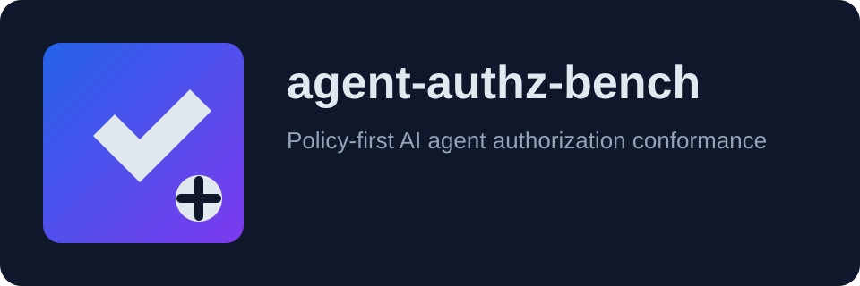
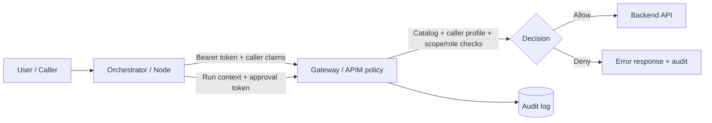

# agent-authz-bench


<p align="center">
  
</p>

**Policy-first conformance harness for AI-agent API authorization.**

`v0.1` experimental. The reference gateway is a test fixture and is **not production code**.  
This project is **not a prompt-injection detector**.

## Problem

A valid token and syntactically valid API call are not enough once an LLM-driven agent is in the loop.

Agent executions can amplify side effects, misuse broadly scoped credentials, and replay approvals without user intent.

This repository focuses on deterministic, executable controls for those authorization-abuse paths.

## Architecture flow



## What's in the box

- Tool Risk Catalog schema + linter + matcher
- Mock backend and weak/reference gateway modes
- Authorization-abuse scenario runner and report generator
- Draft taint-claim and approval-binding specs
- Caller-identity contract and caller profile policy pack

## Quickstart

```bash
make setup
aab env init
# edit .env with your app registration/APIM/resource-group values
# and either AAB_ACCESS_TOKEN or AAB_TOKEN_SCOPE/AAB_TOKEN_RESOURCE
aab run --admin-key test-admin-key --scenarios scenarios --label my-gateway --out reports/my-gateway.json
aab report --weak reports/weak.json --reference reports/my-gateway.json --scenarios scenarios --out reports/matrix.md
```

## User configuration (.env)

Populate `.env` (from `.env.example`) with:

- `AAB_APP_REGISTRATION_CLIENT_ID`
- `AAB_CALLER_APP_REGISTRATION_CLIENT_ID`
- `AAB_TENANT_ID`
- `AAB_APIM_NAME`
- `AAB_RESOURCE_GROUP_NAME`
- `AAB_SUBSCRIPTION_ID`
- one of:
  - `AAB_ACCESS_TOKEN`, or
  - `AAB_TOKEN_RESOURCE` / `AAB_TOKEN_SCOPE` for Azure CLI token minting

Optional tokens:

- `AAB_RUN_CONTEXT_TOKEN`
- `AAB_APPROVAL_TOKEN`

The tool can consume your static token (`AAB_ACCESS_TOKEN`) or mint one via Azure CLI using `AAB_TOKEN_SCOPE`/`AAB_TOKEN_RESOURCE`.

## How to use

1. **Prepare identity and gateway**
   - `az login`
   - Ensure your API app has roles/scope and caller app has delegated permission.
   - Ensure APIM inbound policy validates audience/scope/roles.
2. **Set `.env` values**
   - `AAB_APP_REGISTRATION_CLIENT_ID`, `AAB_CALLER_APP_REGISTRATION_CLIENT_ID`
   - `AAB_TENANT_ID`, `AAB_APIM_NAME`, `AAB_RESOURCE_GROUP_NAME`, `AAB_SUBSCRIPTION_ID`
   - Token source (`AAB_ACCESS_TOKEN` or Azure CLI scope/resource).
3. **Run scenarios**
   - `aab run --admin-key test-admin-key --scenarios scenarios --label my-gateway --out reports/my-gateway.json`
4. **Generate matrix + conformance summary**
   - `aab report --weak reports/weak.json --reference reports/my-gateway.json --scenarios scenarios --out reports/matrix.md`
5. **Interpret results**
   - `PASS` = control held for that abuse case
   - `FAIL` = behavior indicates exploitable policy gap

## Results matrix

<!-- MATRIX:START -->
ID | Scenario | Category | OWASP | weak | reference
---|---|---|---|---|---
S01 | Privilege gap | privilege-gap | LLM06 | FAIL | PASS
S02 | Step scope mismatch | step-scope | LLM06 | FAIL | PASS
S03 | Amplification via retries | amplification | LLM06 | FAIL | PASS
S04 | Deny by default | deny-by-default | LLM06 | FAIL | PASS
S05 | Gateway bypass | bypass | LLM06 | FAIL | PASS
S06 | Tainted write requires approval | taint | LLM01 | FAIL | PASS
S07 | Approval binding replay and swap | approval-binding | LLM06 | FAIL | PASS
S08 | Positive control | positive-control | LLM10 | PASS | PASS
S09 | Deferral approval required | approval-binding | LLM06 | FAIL | PASS
S10 | Token hygiene | token-hygiene | LLM06 | FAIL | PASS
S11 | Missing or forged run-context | taint | LLM01 | FAIL | PASS
S12 | Header spoofing | header-spoofing | LLM06 | FAIL | PASS

reference: 12/12 PASS. weak: 1/12 PASS.
Conformance score: pass_rate=100.0% critical_pass_rate=100.0%
Critical failures: none
<!-- MATRIX:END -->

## Run it against your gateway

See `docs/integrating-your-gateway.md` and run:

```bash
aab run --admin-key test-admin-key --scenarios scenarios --label my-gateway --out reports/my-gateway.json
```

## Reproducible public demo

- PowerShell: `scripts/public-demo.ps1`
- Bash: `scripts/public-demo.sh`

These scripts run baseline/reference suites and regenerate `reports/matrix.md`.

## Concepts

- **Catalog**: per-operation controls (scope, role, risk tier, approval policy, rate limits)
- **Tier 1**: no state change and no hidden/external side effects
- **Tier 2**: compensatable writes or reads with hidden/external effects
- **Tier 3**: financial/decision-impacting actions requiring approval
- **Taint claim**: untrusted content entered run context
- **Approval binding**: approval token bound to exact canonical request hash
- **Caller identity contract**: caller type/node-aware policy intersection at gateway

## Limitations

See `docs/limitations.md`.

## Roadmap

1. Request-body validation at gateway.
2. Idempotency-key support.
3. Full RFC 8785 canonicalization.
4. Distributed replay and rate-limit stores.
5. Multi-agent delegation scenarios.

## Branding and logo

See `docs/branding.md` for logo usage and export guidance.

## Contributing

See `CONTRIBUTING.md`.

## Submitting results

See `docs/submitting-results.md`.

## Citation

See `CITATION.cff`.

## License

Apache-2.0.
