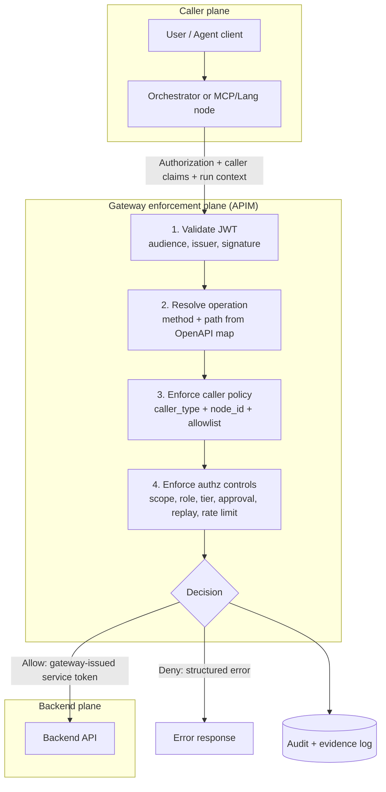

# agent-authz-bench


<p align="center">
  
</p>

**Policy-first conformance harness for AI-agent API authorization.**

`v0.1` experimental. The reference gateway is a test fixture and is **not production code**.  
This project is **not a prompt-injection detector**.

## Problem

A valid token and syntactically valid API call are not enough once an LLM-driven agent is in the loop.

Agent executions can amplify side effects, misuse broadly scoped credentials, and replay approvals without user intent.

This repository focuses on deterministic, executable controls for those authorization-abuse paths.

## Architecture flow



## What's in the box

- Tool Risk Catalog schema + linter + matcher
- Mock backend and weak/reference gateway modes
- Authorization-abuse scenario runner and report generator
- Draft taint-claim and approval-binding specs
- Caller-identity contract and caller profile policy pack

## Start here: run the local demo

The local demo is the recommended first step. It runs entirely on your machine with synthetic
identities, test keys, and loan data; it does **not** require Azure, an Entra tenant, `az login`,
an API key, or an LLM. It starts temporary local services, runs the weak and reference gateway
fixtures, and writes a PASS/FAIL matrix to `reports/matrix.md`.

### Prerequisites

- Git
- Python 3.11 or newer
- Internet access for the initial Python package installation

### Windows PowerShell

```bash
git clone https://github.com/thattechieguy/agent-tool-authz.git
cd agent-tool-authz
.\scripts\public-demo.ps1
```

### macOS or Linux

```bash
git clone https://github.com/thattechieguy/agent-tool-authz.git
cd agent-tool-authz
./scripts/public-demo.sh
```

Expected result: the weak fixture fails the abuse scenarios while the reference fixture passes
them. The test process creates disposable local cryptographic keys; do not reuse them outside the
fixture.

## Test your gateway

Run this only against an isolated test environment. The runner sends intentionally abusive
requests and resets/checks synthetic backend state between scenarios.

### To test your own gateway

1. Run the [local demo](#start-here-run-the-local-demo) to verify your installation.
2. Copy `.env.example` to `.env` and set your test gateway and backend URLs.
3. Configure a test token from your identity provider.
4. Map the sample scenario routes and permissions to your API operations and entitlements.
5. Implement the test-only backend reset endpoint in the [HTTP contract](docs/integrating-your-gateway.md).
6. Run `aab run` against a non-production environment.
7. Use the generated report to correct authorization behavior that differs from the expected result.

You need:

- A reachable non-production gateway and backend.
- A test-only backend admin/reset endpoint compatible with the [HTTP contract](docs/integrating-your-gateway.md).
- Test identities and tokens containing the audience, scopes, roles, and caller-context claims
  expected by your gateway.
- A token source: a static `AAB_ACCESS_TOKEN`, Azure CLI (`az login` plus
  `AAB_TOKEN_SCOPE` or `AAB_TOKEN_RESOURCE`), client credentials, or managed identity.
- Run-context and approval tokens if your gateway enforces those controls.

Install the CLI and create a local configuration file:

```bash
python -m venv .venv
# Windows PowerShell
.\.venv\Scripts\pip install -r requirements-dev.lock
.\.venv\Scripts\aab env init
# macOS/Linux: .venv/bin/pip install -r requirements-dev.lock && .venv/bin/aab env init
```

Set the endpoint and token values in `.env`, using `.env.example` as the field reference, then
run:

```bash
# Windows PowerShell
.\.venv\Scripts\aab run --target https://your-test-gateway --backend https://your-test-backend --admin-key <test-only-admin-key> --scenarios scenarios --label your-gateway --out reports/your-gateway.json

# macOS/Linux
.venv/bin/aab run --target https://your-test-gateway --backend https://your-test-backend --admin-key <test-only-admin-key> --scenarios scenarios --label your-gateway --out reports/your-gateway.json
```

See [integrating your gateway](docs/integrating-your-gateway.md) for request headers, expected
responses, and token-provider integration. Do not supply production credentials or point the
runner at production APIs.

## Azure APIM proof of concept

`azure-poc/` is optional and separate from the local demo. It requires a dev/test Azure
subscription, Microsoft Entra permissions to create app registrations and test users, an APIM
instance, App Service resources, Python 3.11+, and Azure CLI/browser sign-in. It can incur Azure
costs. Follow [the Azure POC guide](azure-poc/README.md) before provisioning anything.

## APIM skeleton workflow (bring your own app registrations)

```bash
# 1) discover scopes/roles + API operations
aab apim discover --openapi examples/apim/loans-backend-openapi.json --out examples/apim/generated/discovery.json

# 2) generate APIM inbound policy + operation permission map
aab apim scaffold --discovery examples/apim/generated/discovery.json

# 3) keep generated artifacts aligned in CI
aab apim drift-check \
  --discovery examples/apim/generated/discovery.json \
  --policy examples/apim/generated/inbound-policy.generated.xml \
  --mapping examples/apim/generated/operation-mapping.generated.yaml
```

Generated artifacts are a reusable starting point: swap OpenAPI + app IDs, regenerate, then apply your own scope/role/caller-context standards.

## Dynamic token downscoping

Reference gateway now supports caller-aware downscoping with fail-closed behavior:

- validates caller claims and operation permissions
- computes minimum required scope/role per operation
- issues a least-privileged backend token
- denies request if downscoping broker fails (when fail-closed is enabled)

See `docs/downscoping.md` for broker contract and Azure Function deployment skeleton.

## User configuration (.env)

Populate `.env` (from `.env.example`) with:

- `AAB_APP_REGISTRATION_CLIENT_ID`
- `AAB_CALLER_APP_REGISTRATION_CLIENT_ID`
- `AAB_TENANT_ID`
- `AAB_APIM_NAME`
- `AAB_RESOURCE_GROUP_NAME`
- `AAB_SUBSCRIPTION_ID`
- one of:
  - `AAB_ACCESS_TOKEN`, or
  - `AAB_TOKEN_RESOURCE` / `AAB_TOKEN_SCOPE` for Azure CLI token minting

Optional tokens:

- `AAB_RUN_CONTEXT_TOKEN`
- `AAB_APPROVAL_TOKEN`

The tool can consume your static token (`AAB_ACCESS_TOKEN`) or mint one via Azure CLI using `AAB_TOKEN_SCOPE`/`AAB_TOKEN_RESOURCE`.

## How to use

1. **Prepare identity and gateway**
   - `az login`
   - Ensure your API app has roles/scope and caller app has delegated permission.
   - Ensure APIM inbound policy validates audience/scope/roles.
2. **Set `.env` values**
   - `AAB_APP_REGISTRATION_CLIENT_ID`, `AAB_CALLER_APP_REGISTRATION_CLIENT_ID`
   - `AAB_TENANT_ID`, `AAB_APIM_NAME`, `AAB_RESOURCE_GROUP_NAME`, `AAB_SUBSCRIPTION_ID`
   - Token source (`AAB_ACCESS_TOKEN` or Azure CLI scope/resource).
3. **Run scenarios**
   - `aab run --admin-key test-admin-key --scenarios scenarios --label my-gateway --out reports/my-gateway.json`
4. **Generate matrix + conformance summary**
   - `aab report --weak reports/weak.json --reference reports/my-gateway.json --scenarios scenarios --out reports/matrix.md`
5. **Interpret results**
   - `PASS` = control held for that abuse case
   - `FAIL` = behavior indicates exploitable policy gap

## Results matrix

<!-- MATRIX:START -->
ID | Scenario | Category | OWASP | weak | reference
---|---|---|---|---|---
S01 | Privilege gap | privilege-gap | LLM06 | FAIL | PASS
S02 | Step scope mismatch | step-scope | LLM06 | FAIL | PASS
S03 | Amplification via retries | amplification | LLM06 | FAIL | PASS
S04 | Deny by default | deny-by-default | LLM06 | FAIL | PASS
S05 | Gateway bypass | bypass | LLM06 | FAIL | PASS
S06 | Tainted write requires approval | taint | LLM01 | FAIL | PASS
S07 | Approval binding replay and swap | approval-binding | LLM06 | FAIL | PASS
S08 | Positive control | positive-control | LLM10 | PASS | PASS
S09 | Deferral approval required | approval-binding | LLM06 | FAIL | PASS
S10 | Token hygiene | token-hygiene | LLM06 | FAIL | PASS
S11 | Missing or forged run-context | taint | LLM01 | FAIL | PASS
S12 | Header spoofing | header-spoofing | LLM06 | FAIL | PASS
S13 | Caller type required | caller-context | LLM06 | FAIL | PASS
S14 | Node header mismatch | caller-context | LLM06 | FAIL | PASS
S15 | Node policy boundary | caller-context | LLM06 | FAIL | PASS
S16 | Caller profile deny | caller-context | LLM06 | FAIL | PASS

reference: 16/16 PASS. weak: 1/16 PASS.
Conformance score: pass_rate=100.0% critical_pass_rate=100.0%
Critical failures: none
<!-- MATRIX:END -->

## Run it against your gateway

See `docs/integrating-your-gateway.md` and run:

```bash
aab run --admin-key test-admin-key --scenarios scenarios --label my-gateway --out reports/my-gateway.json
```

## Reproducible public demo

- PowerShell: `scripts/public-demo.ps1`
- Bash: `scripts/public-demo.sh`

These scripts run baseline/reference suites and regenerate `reports/matrix.md`.

## Concepts

- **Catalog**: per-operation controls (scope, role, risk tier, approval policy, rate limits)
- **Tier 1**: no state change and no hidden/external side effects
- **Tier 2**: compensatable writes or reads with hidden/external effects
- **Tier 3**: financial/decision-impacting actions requiring approval
- **Taint claim**: untrusted content entered run context
- **Approval binding**: approval token bound to exact canonical request hash
- **Caller identity contract**: caller type/node-aware policy intersection at gateway

## Limitations

See `docs/limitations.md`.

## Roadmap

1. Request-body validation at gateway.
2. Idempotency-key support.
3. Full RFC 8785 canonicalization.
4. Distributed replay and rate-limit stores.
5. Multi-agent delegation scenarios.

Maturity benchmark profile: `benchmarks/apim-maturity-profile.yaml`.

## Branding and logo

See `docs/branding.md` for logo usage and export guidance.

## Contributing

See `CONTRIBUTING.md`.

## Submitting results

See `docs/submitting-results.md`.

## Citation

See `CITATION.cff`.

## License

Apache-2.0.
